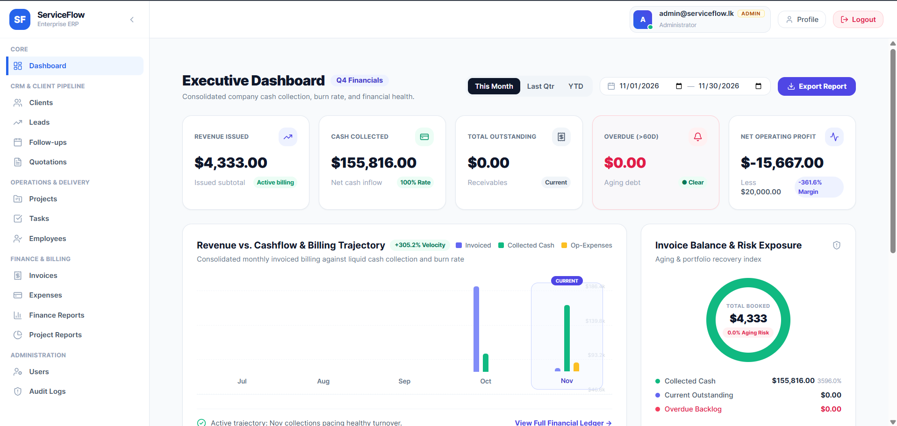
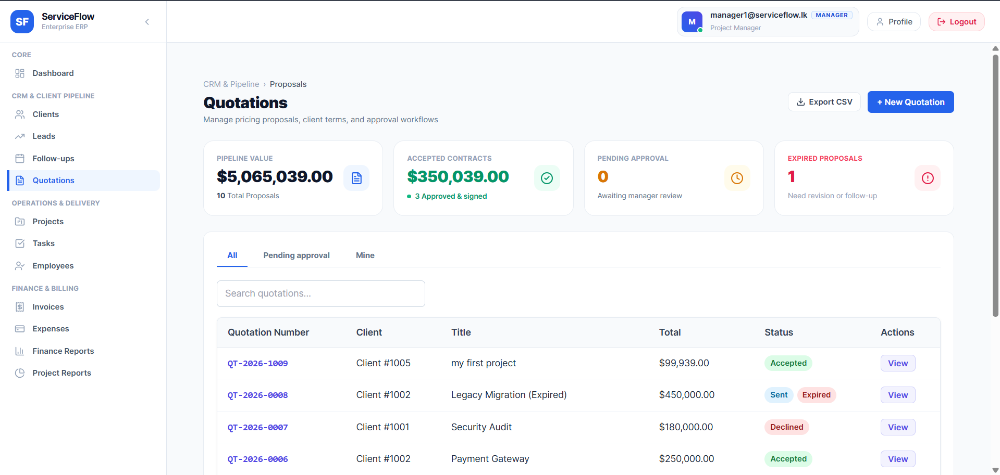
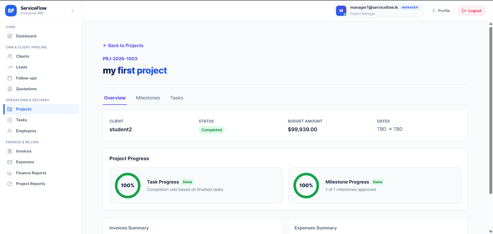
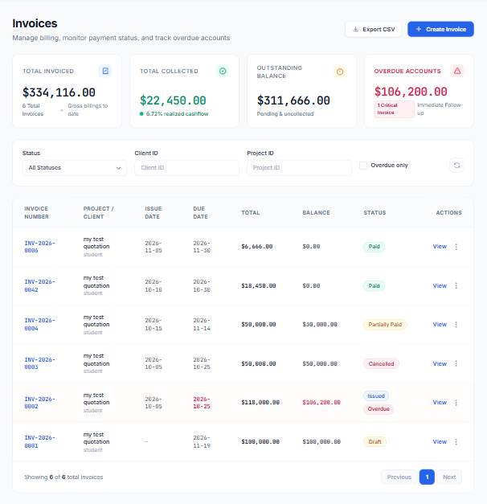
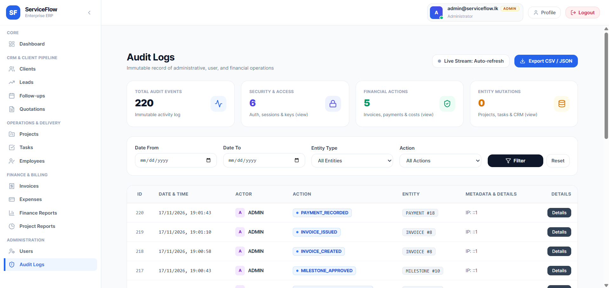
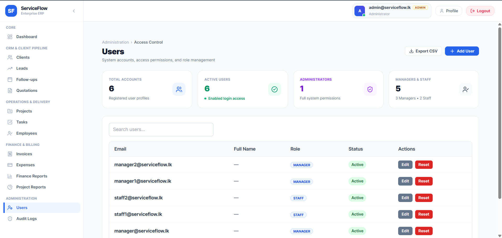

# ServiceFlow ERP

> **Enterprise Project & Service Operations Platform** — High-assurance, full-lifecycle ERP engineered for project-based professional services and engineering consultancies.

[](https://github.com/Prabod-Sandaruwan/serviceflow-erp/actions)
[](https://www.typescriptlang.org/)
[](https://react.dev/)
[](https://expressjs.com/)
[](https://www.prisma.io/)
[](https://www.mysql.com/)
[](tests)
[](docs/SECURITY.md)

---



---

## Enterprise Core Capabilities

- **Lead-to-Cash Lifecycle**: Lead pipeline, interactive quotations, dual-authorization approval, automated milestone conversion.
- **Project & Milestone Governance**: Sprint tracking, resource allocation, and milestone-linked revenue recognition.
- **Financial & Receivables Engine**: Invoicing, automated dunning notifications, payment reconciliations, and expense tracking.
- **Executive Business Intelligence**: Dynamic revenue trajectory curves, real-time margin analysis, and overdue risk exposure.
- **Enterprise Defense-in-Depth**: Strict RBAC, CSRF mitigation, formula injection hardening, and immutable audit logs.

---

## Enterprise Documentation Suite

Detailed architecture specifications, security controls, and operational manuals:

| Document                                                                                                        | Focus & Scope                                                                            |
| :-------------------------------------------------------------------------------------------------------------- | :--------------------------------------------------------------------------------------- |
| **[Architecture Specification](docs/ARCHITECTURE.md)**                                                          | Multi-tier topology, transactional boundaries, state machines, and concurrency controls. |
| **[Security & Compliance Guide](docs/SECURITY.md)**                                                             | Argon2id auth, CWE-1236/521/400 remediations, CSRF protection, and audit logging.        |
| **[Role & Operations Manual](docs/ROLE_GUIDE.md)**                                                              | Workflows and permissions for `ADMIN`, `MANAGER`, and `STAFF` personas.                  |
| **[Deployment & Operations](docs/DEPLOYMENT.md)**                                                               | Production infrastructure, Nginx reverse proxy configuration, pooling, and backups.      |
| **[Visual Interface Gallery](docs/GALLERY.md)**                                                                 | Full-resolution screenshot tour of all core modules with feature breakdowns.             |
| **[Technical Design Document](file:///docs/ServiceFlow%20ERP%20%E2%80%93%20Technical%20Design%20Document.pdf)** | Formal system architecture, data models, and API specifications.                         |

---

## Application Interface Showcase

|                         Executive Dashboard                          |                       Quotations & Dual Approval                        |
| :------------------------------------------------------------------: | :---------------------------------------------------------------------: |
| [](docs/images/dashboard.png) | [](docs/images/quotations.png) |
|                    **Active Projects & Sprints**                     |                       **Receivables & Invoicing**                       |
|  [](docs/images/projects.png)   |    [](docs/images/invoices.png)    |
|                    **Human-Friendly Audit Trail**                    |                     **User Management & Security**                      |
|    [](docs/images/audit.png)    |        [](docs/images/users.png)         |

> 📷 **View complete tour with descriptions in the [Visual Interface Gallery](docs/GALLERY.md)**. Interactive API Explorer: `http://localhost:3000/api-docs`.

---

## Quickstart & Local Setup

```powershell
# 1. Clone repository & install dependencies
git clone https://github.com/Prabod-Sandaruwan/serviceflow-erp.git; cd serviceflow-erp
npm install --prefix server; npm install --prefix client

# 2. Configure environment files & initialize database
Copy-Item server/.env.example server/.env; Copy-Item client/.env.example client/.env
mysql -u root -p -e "CREATE DATABASE serviceflow_dev; CREATE DATABASE serviceflow_test;"
npm run db:migrate --prefix server; npm run db:seed --prefix server

# 3. Start development servers (API: :3000 | Web UI: :5173)
npm run dev
```

---

## Verification & Quality Gates

```powershell
npm run typecheck    # Strict TypeScript compiler verification without emit
npm run format:check # Prettier code standard validation
npm test             # Full automated test suite (Unit, Integration, Authorization Matrix)
npm run test:e2e     # Deterministic Playwright end-to-end user journeys
```

---

## License & Governance

Licensed under the [MIT License](LICENSE). Maintained by the ServiceFlow Engineering Team.
