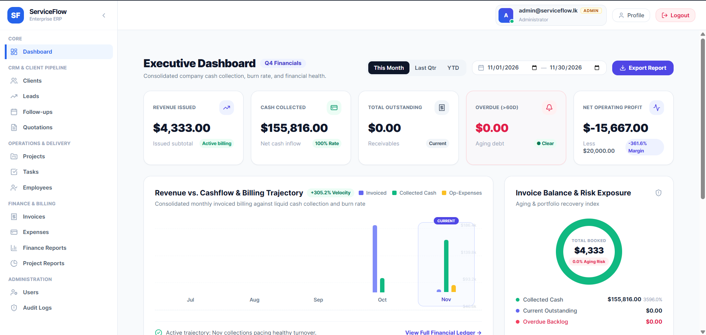
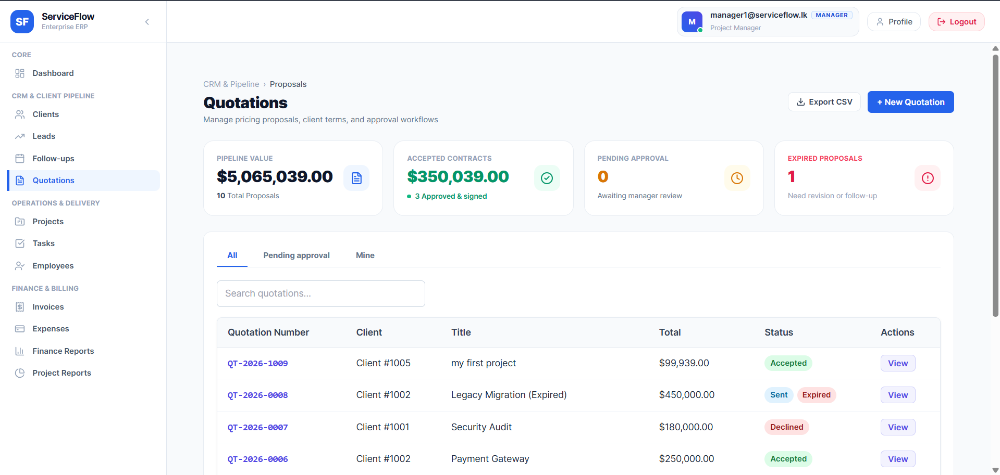
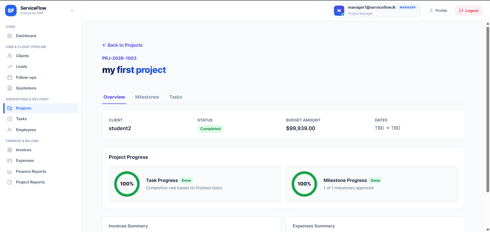
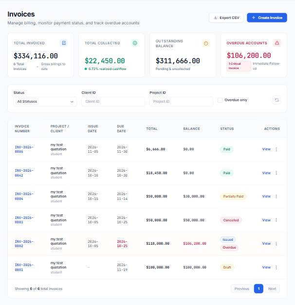
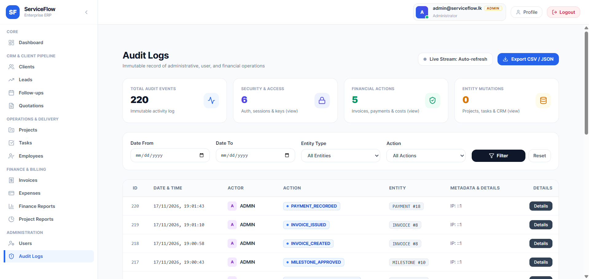
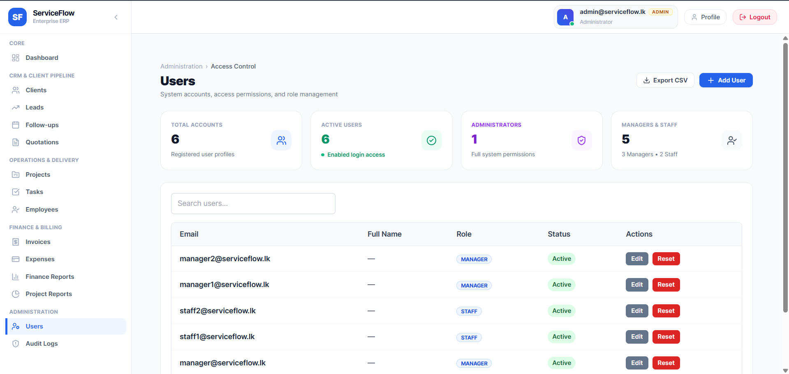
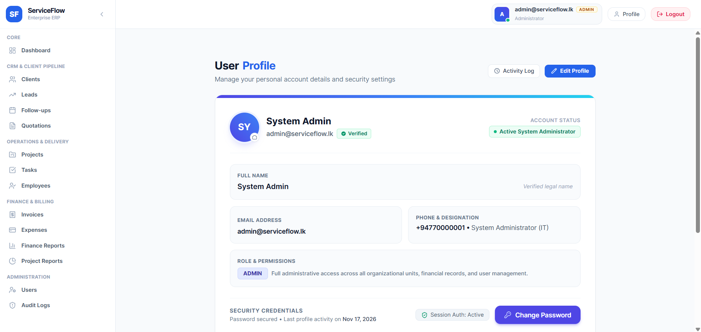

# ServiceFlow ERP — Visual Interface Gallery

High-resolution visual tour of ServiceFlow ERP's mission-critical operational modules.

---

## 1. Executive Dashboard & Real-Time KPIs

> **Key Capabilities**: Real-time billing volume, collections velocity badges, dynamic margin curves, and overdue risk donut.

---

## 2. Interactive Quotations & Dual Approval

> **Key Capabilities**: Itemized pricing, VAT/SSCL calculation, creator self-approval prevention, and one-click project conversion.

---

## 3. Project Delivery & Milestone Governance

> **Key Capabilities**: Sprint progress, milestone completion tracking, billing eligibility gates, and team task assignments.

---

## 4. Invoicing & Receivables Management

> **Key Capabilities**: Invoice lifecycle (`DRAFT` → `ISSUED` → `PAID`), payment allocations, and automated dunning dispatch.

---

## 5. Security & Human-Friendly Audit Trail

> **Key Capabilities**: Human-readable field diffs (`Previous Value` → `New Value`), IP tracking, and request ID correlation.

---

## 6. Enterprise User & Access Management

> **Key Capabilities**: Multi-tier RBAC (`ADMIN`, `MANAGER`, `STAFF`), employee linkages, and strict password reset policies.

---

## 7. Profile & Security Credentials

> **Key Capabilities**: Self-service profile updates, password rotation with complexity validation, and session termination.
